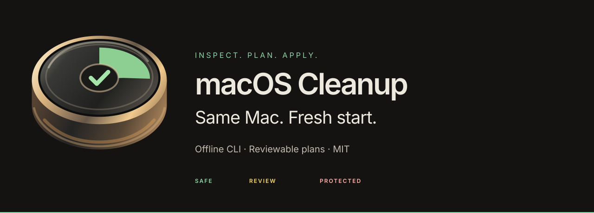

[🇺🇸 EN](README.md) | [🇵🇱 PL](README.pl.md) | [🇪🇸 ES](README.es.md) | [🇫🇷 FR](README.fr.md) | [🇩🇪 DE](README.de.md) | [🇮🇹 IT](README.it.md) | [🇵🇹 PT](README.pt.md)

---

<p align="center">
  <a href="https://macos-cleanup.64bit.site/"></a>
</p>

# macOS Cleanup — Same Mac. Fresh start.

> A local, open-source command-line tool for careful macOS cleanup. Analyze first, review a plan, and choose what to apply.

[Explore the website](https://macos-cleanup.64bit.site/) · [Support](https://macos-cleanup.64bit.site/support) · [GitHub stars](https://github.com/KasprowiczM/macOS_cleanup/stargazers) · MIT License

## What is this project?

`cleanup_all.sh` is a bash script designed for advanced macOS users that:

- **Analyzes** the system and identifies what can be safely removed
- **Informs** you about the consequences of each operation before executing it
- **Waits for your consent** — the default answer is always NO
- **Moves user data to quarantine** during cleanup modes, so rollback is possible
- **Never touches** mail data, passwords, cookies, browser profiles, or documents
- Some native command operations have no rollback; review their consequences before applying them.

The CLI runs locally and does not send system paths, cleanup results, or usage telemetry to an operator service. It does not use `sudo`; system caches are report-only. Quarantine preserves a rollback path but frees **0 bytes** on APFS until you permanently purge the quarantined run. After a purge, APFS snapshots may still retain blocks as Purgeable space; when those blocks are reclaimed is controlled by macOS.

## Requirements

- Officially supported on Apple Silicon Macs running macOS 11 Big Sur or newer. The v3.0.7 CLI technical minimum is macOS 10.15; Intel is not blocked by the code but is outside official support.
- bash 3.2+ (pre-installed on macOS)
- Python 3.10+ for auxiliary tools `dev-sync/` and safe parsing of `plan.json` in `apply --from-plan`
- Optional: `bc` (for size calculations), `mdfind` (Spotlight, pre-installed)

## Installation

### Quick test — one-line installer

```bash
/bin/bash -c "$(curl -fsSL https://raw.githubusercontent.com/KasprowiczM/macOS_cleanup/main/install.sh)"
```

The installer **only clones the repo and prints the next steps** — it does not delete anything and does not run the cleanup. It defaults to installing in `~/Dev_Env/macOS_cleanup` (can be changed via `MACOS_CLEANUP_DIR=...`). Prefer to review the code first? Download and inspect [`install.sh`](install.sh) before running. After cloning, it checks every runtime script, rule file and schema against `SHA256SUMS` and aborts on a mismatch or when the file is missing. This catches a damaged or partial download; it is not a signature.

### Manual Installation

```bash
git clone https://github.com/KasprowiczM/macOS_cleanup.git ~/Dev_Env/macOS_cleanup
cd ~/Dev_Env/macOS_cleanup
chmod +x cleanup_all.sh
```

## How to use

### 1. Recommended first run — analysis (dry-run)

```bash
bash cleanup_all.sh
```

The script will analyze your system, show what can be cleaned, and ask if you want to proceed to cleanup. **Nothing will be deleted without your consent.**

### 2. Full interactive cleanup

```bash
bash cleanup_all.sh --interactive
```

Goes through each category explaining what it is, what the consequences of removal are, and asks for your permission. The default real cleanup operates in `--quarantine` mode: user paths are moved to `~/Library/Application Support/macOS_cleanup/quarantine` rather than being immediately deleted.

If you want to permanently recover space right after a dry-run, run the permanent mode:

```bash
bash cleanup_all.sh --interactive --permanent
```

### 3. Automatic cleanup of strictly safe items only

```bash
bash cleanup_all.sh --auto-safe
```

By default, this moves explicitly known, low-risk application caches to quarantine. Generic top-level `~/Library/Caches` items are reported for user decision, as they might represent large offline caches that the application would have to re-download. Temporary files and paths outside of `$HOME` require the `--permanent` mode because they lack a sensible rollback mechanism:

```bash
bash cleanup_all.sh --auto-safe --permanent
```

The rest is reported for your decision.

### 4. Specific category

```bash
bash cleanup_all.sh --interactive --category dev
bash cleanup_all.sh --dry-run --category user-caches
bash cleanup_all.sh --interactive --category time-machine
```

### 5. Analyze / plan / apply

```bash
# Read-only analysis
bash cleanup_all.sh --dry-run

# Analysis + structural JSON plan
bash cleanup_all.sh plan --plan-file plan.json

# Plan execution: default SAFE only
bash cleanup_all.sh apply --from-plan plan.json

# Simulation of plan execution
bash cleanup_all.sh apply --from-plan plan.json --dry-run
```

`plan.json` contains operations with an `id`, path or command, category, class (`SAFE`/`REVIEW`/`DANGEROUS`), estimated size, impact description, and recommendation. `apply --from-plan` never executes `DANGEROUS`; `REVIEW` is skipped unless you add `--include-review` and pass the interactive confirmation.

### 6. Non-interactive mode (CI/automation)

```bash
# Analysis without questions
bash cleanup_all.sh --dry-run --non-interactive

# Auto-safe without manual confirmation (approves SAFE risk categories only; REVIEW categories require interactive confirmation)
bash cleanup_all.sh --auto-safe --non-interactive --yes

# Real space recovery in automation: only after conscious --permanent (SAFE categories only)
bash cleanup_all.sh --auto-safe --permanent --non-interactive --yes

# Running a specific category without prompts
bash cleanup_all.sh --dry-run --non-interactive --category app-leftovers
```

`--non-interactive` runs the script without reading input from TTY. For safety, every question defaults to `no`. `--yes` automatically confirms `SAFE` risk categories only (such as allowlisted app caches); `REVIEW` categories require interactive confirmation and are skipped in unattended non-interactive runs.

### 7. With path exclusion

```bash
bash cleanup_all.sh --interactive --exclude "$HOME/Library/Caches/myapp"
```

### 8. Quarantine, restore, and purge

```bash
# List saved quarantine runs
bash cleanup_all.sh --list-quarantine

# Restore the latest run or a specific manifest
bash cleanup_all.sh --restore latest
bash cleanup_all.sh --restore reports/restore_<run_id>.tsv

# Preview permanent quarantine deletion
bash cleanup_all.sh --purge-quarantine latest

# Actual space recovery occupied by quarantine
bash cleanup_all.sh --purge-quarantine latest --apply

# Purge runs older than the retention period
bash cleanup_all.sh --purge-quarantine expired --retention-days 30 --apply
```

Quarantine provides rollback, but it doesn't free up disk space by itself. You recover space only after using `--permanent` or a subsequent `--purge-quarantine ... --apply`.

### 9. Prune aged run logs and reports (`--prune-artifacts`)

```bash
bash cleanup_all.sh --prune-artifacts
```

Analyze, list, plan, and dry-run never delete logs or journals. Artifact retention is this explicit command only. Age is controlled by `ARTIFACT_RETENTION_DAYS` (0 disables).

### 10. JSON output — machine-readable results (`--json`)

```bash
# Analytical output (dry-run) in JSON format to stdout
bash cleanup_all.sh --dry-run --non-interactive --json --category dev

# Combine with pipes (human output goes to stderr)
bash cleanup_all.sh plan --json --non-interactive 2>/dev/null | jq .counters

# Save JSON to file and skip the Markdown report
bash cleanup_all.sh --dry-run --non-interactive --json --category trash 2>/dev/null > summary.json
```

The `--json` flag redirects all human-readable output (banners, sections, summary) to **stderr** and emits a single JSON object to **stdout** at the end of the run. The object contains:

| Field | Description |
|------|------|
| `mode` | Execution mode (`dry-run`, `plan`, `apply-plan`, etc.) |
| `dry_run` | `true` / `false` |
| `analysis_status` | `complete` / `partial` |
| `categories` | Array of active categories |
| `counters` | `would_free_bytes`, `cleaned_bytes`, `informational_bytes`, `quarantined_bytes`, `skipped_items`, `unreadable_paths`, `user_decisions_needed` |
| `plan` | `SAFE`/`REVIEW`/`DANGEROUS` operation counters and bytes; `report_only_operations`, `report_only_bytes`, `executable_bytes` |
| `artifacts` | Paths to `report`, `plan`, `journal`, `restore_manifest` |
| `warnings` | Number of skipped items |
| `user_decisions` | List of descriptions for items requiring a decision |

The flag works with every mode (`dry-run`, `plan`, `apply`, `--auto-safe`, etc.) and is safe for `--non-interactive` and CI. It doesn't change any behavior if omitted.

## Available Categories

| Category | Contents |
|-----------|-----------|
| `trash` | Contents of ~/.Trash |
| `system` | System caches, old /tmp and /private/tmp files |
| `user-caches` | ~/Library/Caches (user application caches) |
| `logs` | Old application and system logs |
| `app-leftovers` | Heuristic leftovers report; no automatic removal by default |
| `dev` | Xcode DerivedData, simulators, npm/pip/brew/docker caches |
| `time-machine` | Local TM snapshots + iOS backups |
| `large-files` | Old DMG/PKG/ISO files in ~/Downloads |

## Safety Model

### Philosophy: Informed Consent

The script operates on an **informed consent** model:

```
Analyze → Show results → Explain consequences → Warnings → Wait for consent → Act
```

The target UX/DX language describes this flow as **analyze → plan → apply**:

- `analyze` — non-mutating dry-run, e.g., `bash cleanup_all.sh --dry-run`
- `plan` — Markdown report, JSONL journal, and list of items requiring decisions
- `apply` — real action after consent: `apply --from-plan`, `--interactive`, `--auto-safe`, or `--purge-quarantine ... --apply`

Detailed model for operators and agents: `docs/ux_dx_safety_model.md`.

### What is NEVER touched

<!-- BEGIN NEVER_TOUCH_PATHS -->
- `~/Library/Mail`
- `~/Library/Containers/com.apple.mail`
- `~/Library/Keychains`
- `/Library/Keychains`
- `/System/Library/Keychains`
- `~/Library/Application Support/1Password`
- `~/Library/Application Support/1Password 7`
- `~/Library/Application Support/com.agilebits`
- `~/Library/Application Support/Bitwarden`
- `~/Library/Application Support/LastPass`
- `~/Library/Application Support/Dashlane`
- `~/Library/Application Support/Enpass`
- `~/Library/Application Support/Keybase`
- `~/Library/Application Support/macOS_cleanup`
- `~/Library/Caches/com.1password.1password`
- `~/Library/Caches/com.agilebits.onepassword7`
- `~/Library/Caches/com.bitwarden.desktop`
- `~/Library/Caches/com.lastpass.LastPass`
- `~/Library/Caches/com.dashlane.Dashlane`
- `~/Library/Caches/in.sinew.Enpass-Desktop`
- `~/Documents`
- `~/Desktop`
- `~/Pictures/Photos Library.photoslibrary`
- `~/Pictures/Photos Library`
- `~/Music/Music/Music Library.musiclibrary`
- `~/Music/Music Library.musiclibrary`
- `~/Movies`
- `~/Library/Messages`
- `~/Library/Calendars`
- `~/Library/Application Support/AddressBook`
- `~/Library/Mobile Documents`
- `~/Library/CloudStorage`
- `~/Dropbox`
- `~/OneDrive`
- `~/Google Drive`
- `~/Library/Application Support/Google/DriveFS`
- `~/Library/Application Support/Google/Chrome`
- `~/Library/Application Support/Firefox`
- `~/Library/Application Support/Microsoft Edge`
- `~/Library/Application Support/BraveSoftware`
- `~/Library/Application Support/Opera`
- `~/Library/Application Support/Vivaldi`
- `~/Library/Safari`
- `~/Library/MobileDevice/Provisioning Profiles`
- `~/Library/Keychains`
- `~/Developer`
- `~/Projects`
- `~/src`
- `~/code`
- `~/repos`
- `~/.ssh`
- `~/.gnupg`
- `~/.aws/credentials`
- `~/.aws/config`
- `~/.aws/sso`
- `~/.gitconfig`
- `~/.git-credentials`
- `~/.config`
- `~/.kube`
- `~/.docker`
- `~/.netrc`
- `~/.zshrc`
- `~/.zprofile`
- `~/.zsh_history`
- `~/.bash_profile`
- `~/.bashrc`
- `~/.bash_history`
- `~/.profile`
- `~/.npmrc`
- `~/.config/gh`
<!-- END NEVER_TOUCH_PATHS -->

### Rule Safety Levels

- `SAFE` — reproducible artifacts, e.g., precisely known app caches; can be included in `--auto-safe`, still gated by guardrails
- `REVIEW` — requires a plan and user decision, e.g., generic caches, logs, build artifacts, iOS backups
- `DANGEROUS` — user data, identity, profiles, mail, passwords; never removed automatically

The current `cleanup_rules.yaml` maintains technical values `safe`, `ask`, `never`. The UX/DX mapping translates these to `SAFE`, `REVIEW`, `DANGEROUS` respectively.

### Journal and Rollback

Every report writes a machine-readable plan summary to `reports/journal_*.jsonl` (`report_generated`, `category_total`). Real `safe_remove()` operations append execution events like `quarantined`, `deleted`, `skipped_non_user_scope`. Controlled native commands, such as `brew cleanup`, `docker system prune`, `xcrun simctl delete unavailable`, and `tmutil deletelocalsnapshots` append `native_command` events because they lack a quarantine rollback. Quarantine also produces a `reports/restore_*.tsv`, which `--restore` uses. Restore refuses to recover outside the user directory, to protected paths, via symlinked parent directories, or from files outside the quarantine directory.

Quarantine is a rollback, not a backup. Before the first real cleanup, the user should still have an up-to-date system backup. Mail and browser profiles are treated strictly as pointers: their caches might be reported, but account data, sessions, cookies, bookmarks, and local message stores remain outside automated cleanup.

## Project Structure

```
macOS_cleanup/
├── cleanup_all.sh          # Main script — entry point
├── cleanup_rules.yaml      # Knowledge base: per-application cleanup rules
├── config/
│   └── defaults.sh         # Default config, age thresholds, protected paths
├── lib/
│   ├── common.sh           # Logging, formatting, safe_remove(), path protection
│   ├── policy.sh           # YAML policy parser and SAFE/REVIEW/DANGEROUS mapping
│   ├── analyzer.sh         # System analysis (all analyze_* functions)
│   ├── cleaner.sh          # Cleanup engine (all clean_* functions)
│   ├── planner.sh          # plan.json and apply --from-plan
│   ├── interactive.sh      # User prompts and confirmations
│   └── reporter.sh         # Markdown report generator
├── docs/
│   ├── rules_design.md     # Rules structure documentation
│   └── ux_dx_safety_model.md # SAFE/REVIEW/DANGEROUS model and analyze/plan/apply
├── dev-sync/               # Auxiliary sync for private local overlay
├── DEV_SCRIPTS_README.md   # Operator guide for dev-sync
├── DESIGN.md               # UX/UI design system for reports and prototypes
├── logs/                   # Execution logs (auto-generated)
├── reports/                # Markdown reports, JSONL journal, and restore manifests
├── tests/                  # Test scenarios
├── AGENTS.md               # Role of AI agents in the project
├── CLAUDE.md               # Instructions for Claude / Cowork
├── CODEX.md                # Instructions for code-focused assistants
└── GEMINI.md               # Instructions for Gemini models
```

## Reports and Logs

After every run, the script generates:

- **Log**: `logs/cleanup_YYYY-MM-DD_HHMMSS_PID.log` — full operation diary
- **Report**: `reports/report_YYYY-MM-DD_HHMMSS_PID.md` — Markdown summary
- **Plan**: `reports/plan_YYYY-MM-DD_HHMMSS_PID.json` — structural `SAFE`/`REVIEW`/`DANGEROUS` plan
- **Journal**: `reports/journal_YYYY-MM-DD_HHMMSS_PID.jsonl` — machine-readable plan and operation audit
- **Restore Manifest**: `reports/restore_YYYY-MM-DD_HHMMSS_PID.tsv` — paths required for quarantine rollback

```bash
# Open the last report
open reports/$(ls -t reports/ | head -1)
```

## Dev-sync and Agent Map

`dev-sync/` is an auxiliary system for restoring private local files after cloning onto a new machine. Git remains the source of truth for tracked source; the provider only stores the manifest-backed overlay. Start:

```bash
bash dev-sync/provider_setup.sh
bash dev-sync/dev-sync-export.sh --dry-run --verbose
```

Details: `DEV_SCRIPTS_README.md`.

Generated agent maps and captured machine baselines are local, ignored development artifacts. See [public-source maintenance](docs/PUBLIC_SOURCE.md) for history changes and local verification.

## Extension and Configuration

### Adding a new app to the rules database

Edit `cleanup_rules.yaml` and add an entry following this schema:

```yaml
- name: "App Name"
  bundle_ids:
    - "com.vendor.appname"
  type: dev-tool   # browser|mail|dev-tool|media-editor|system|...
  paths:
    - path: "~/Library/Caches/com.vendor.appname"
      type: cache
      safety: ask   # safe | ask | never
      notes: "Description of what this is and whether it is safe"
```

### Changing Age Thresholds

Edit `config/defaults.sh`:

```bash
LOG_MAX_AGE_DAYS=30       # Logs older than N days
TMP_MAX_AGE_HOURS=24      # Tmp files older than N hours
DMG_MAX_AGE_DAYS=30       # DMG/PKG in ~/Downloads
```

## Disclaimer

> **You use this script at your own risk.** The script is designed with safety in mind and always asks before deleting, but no software is bug-free. Make sure you have an up-to-date backup before your first non-dry-run execution.

---

## 🌍 Landing Page & UI Preview

<p align="center">
  <a href="https://macos-cleanup.64bit.site">
    <br/>
    <strong>Visit Official Website for full details and documentation</strong>
  </a>
</p>

---

Project: `macOS_cleanup` | Version: 3.0.7 | License: MIT
